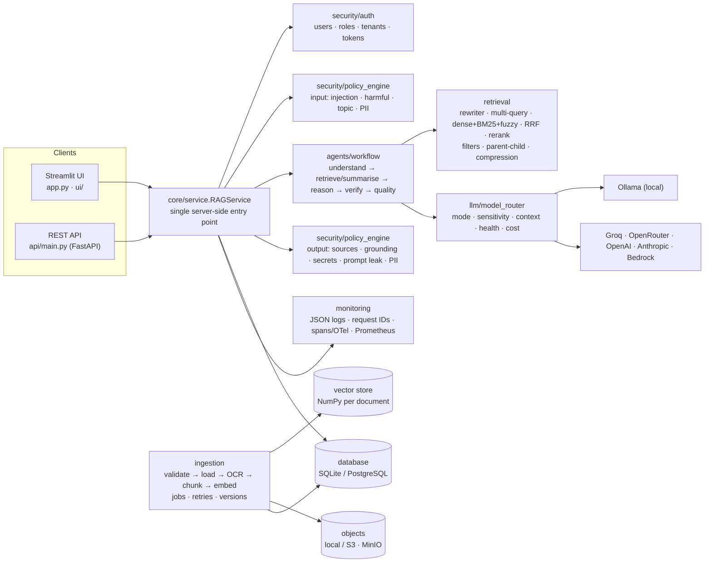
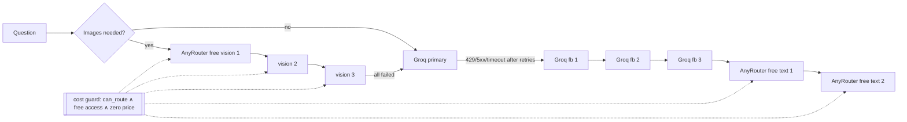
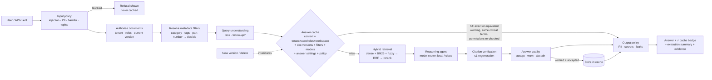
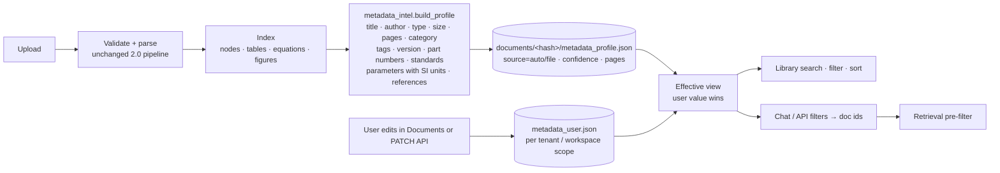
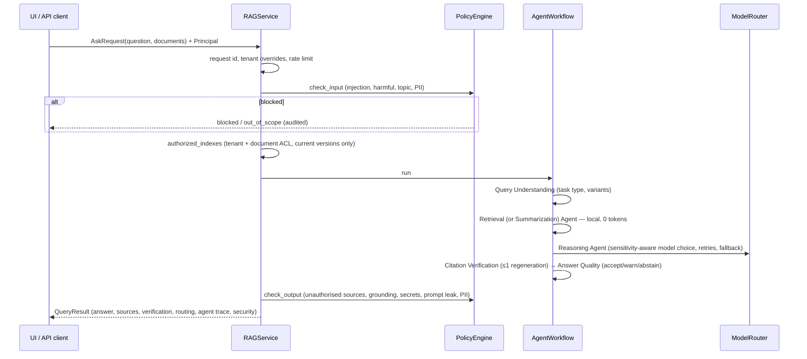

# Architecture — RAG Ultimate 2.0 (2.1 additions at the end of the overview)

## System overview




## 2.2 additions — free-model fallback chains

`llm/discovery.py` builds two independent chains from the providers' live catalogues — TEXT: Groq primary +
3 Groq fallbacks → 2 AnyRouter verified-free text models; VISION: 3 AnyRouter verified-free vision models — and
`llm/catalog.cost_guard()` blocks every non-verified-free model before each call. The existing `ModelRouter` runs
both (new `generate_text` / `analyze_image` / `generate_multimodal_response` wrappers). Full flow, error policy
and guarantees: [docs/MODEL_ROUTING.md](docs/MODEL_ROUTING.md).



## 2.1 additions (UI/UX + intelligence)

All 2.1 features are **additions** around the unchanged 2.0 pipeline; `RAGService` stays the single entry point.

| Module | Role |
|---|---|
| `ops/answer_cache.py` (v2, v1 API kept) | `AnswerCache`: canonical questions, critical-term guard, context-scoped lookups, TTL+LRU, permission revalidation, invalidation by document hash, per-tenant clear, statistics |
| `core/service.RAGService.cache_scope()` | security boundary of cached answers (tenant · user or roles · workspace · model · policy fingerprint) |
| `agents/rag_pro.answer_pro(cache_scope=…)` | builds the cache context (document versions, filters, all answer-shaping settings), stores only verified answers |
| `agents/workflow.py` | removes an answer from the cache again when the quality agent does not accept it; "Answer Cache" trace entry |
| `rag/metadata_intel.py` | deterministic metadata profile with provenance, confidence and SI units |
| `storage/metadata_store.py` | auto profiles + user metadata per scope (JSON next to the document; no migration) and doc-level filter resolution |
| `retrieval/hybrid_search.MetadataFilter` | + `part_numbers`, `parameter_kinds` (passage level); old filters unchanged |
| `ui/faq.py` | deterministic help assistant (47 Q&A, 12 categories, page-aware, fallback to help panels + USER_GUIDE.md) |
| `ui/styles.py`, `ui/help_content.py`, `ui/widgets.py` | design system, page headers (what/why/how/after/errors), onboarding, KPI tiles, answer summary |
| `ui/admin_pages.cache_page` | ⚡ Cache & help administration |

### Question flow with the answer cache





### Metadata flow





### Cache correctness rules
* **Key = context + canonical question.** Context includes tenant, user (or, with `ANSWER_CACHE_SCOPE=tenant`,
  the role set), workspace (no-account mode), model override and mode, a fingerprint of the tenant security policy,
  the *content hashes* of the authorised documents (= exact versions), resolved filters, embedding/master/verifier
  models and every answer-shaping setting (top-k, context sizes, temperature, max tokens, reasoning effort,
  regenerations, agent mode/steps, rewriting, concept linking, support threshold, abstention…).
* **Equivalence**: exact canonical match, or RapidFuzz similarity ≥ `ANSWER_CACHE_SIMILARITY` **and** identical
  critical terms (numbers, identifiers, negations, min/max/typical…).
* **Never cached**: blocked/out-of-scope (stopped before the workflow), follow-ups, summaries, not-found,
  abstained, evidence-only, unverified/ungrounded, invalid citations, no sources, budget/provider-degraded
  answers, answers the quality agent warns about. Each refusal reason is counted (admin page).
* **On hit**: cited document ids must be a subset of the documents the caller may read *now*; output policy
  (PII, secrets) runs again on the cached answer; telemetry records the saved tokens/cost.
* **Invalidation**: new document version or deletion → `invalidate_docs(content hashes)`; TTL; LRU; per-tenant clear.
* **Backend**: in-process memory (existing infrastructure). Redis was deliberately **not** added: a shared cache
  would need serialisation of `QueryResult` objects (pickle from a network store is a code-execution risk) and a
  new service; with per-process caches each replica simply warms its own. The interface (`lookup/store/
  invalidate_docs/clear/stats`) is isolated so a signed-JSON Redis backend can be added later.

## Request lifecycle



## Module map (target layout → implementation)

| Target (master prompt) | Implemented in | Notes |
|---|---|---|
| `app.py`, `frontend/` | `app.py`, `ui/pages.py`, `ui/admin_pages.py`, `ui/widgets.py`, `ui/styles.py` | 14 pages in 3 sections |
| `api/routes, middleware, schemas` | `api/main.py`, `api/schemas.py` | request-id middleware, token auth |
| `config/settings.py`, `logging_config.py` | `config/` | every value from env / `.env` / Streamlit secrets |
| `core/orchestrator, pipeline, model_router, session_manager` | `core/service.py`, `core/documents.py`, `core/model_config.py`, `agents/workflow.py`, `llm/model_router.py`, `ui/state.py` | no duplicate orchestrators |
| `ingestion/loaders, parser, ocr, chunker, metadata, processor` | `ingestion/*`, `rag/pdf_parser.py`, `rag/metadata.py` | PDF keeps its specialised parser |
| `retrieval/embeddings, vector_store, bm25, hybrid_search, reranker, query_rewriter` | `rag/embeddings.py`, `storage/vector_store.py`, `retrieval/*` | |
| `generation/llm_factory, prompt_manager, answer_generator, citation_manager` | `llm/providers.py` + `llm/adapters.py` (factory: `make_provider`), `rag/prompts.py`, `agents/master.py`, `agents/master.EvidenceRegistry` + `agents/verifier.canonicalize` | |
| `agents/*` | `agents/orchestrator.py`, `specialists.py`, `retrieval_stage.py`, `master.py`, `verifier.py`, `workflow.py` | |
| `security/*` | `security/*` | |
| `evaluation/*` | `evaluation/*` (+ 1.x `metrics/`) | |
| `database/models, repository, migrations` | `database/*` | |
| `monitoring/*` | `monitoring/*` (+ `ops/telemetry.py`) | |
| `deployment/`, `Dockerfile`, `docker-compose.yml` | same | profiles local / hybrid / production / monitoring |

## Key design decisions

| Decision | Choice | Reason |
|---|---|---|
| Vector store | NumPy matrix per document, keyed by content hash | hybrid scoring touches every node anyway; datasheet-scale corpora; no extra service; pgvector unavailable to test here |
| Database | SQLAlchemy + own versioned migrator | one code path for SQLite and PostgreSQL, migrations are plain Python |
| LLM access | httpx adapters (boto3 only for Bedrock) | explicit, testable wire formats; no SDK lock-in |
| Agents | fixed deterministic sequence, rule-based routing | predictable, cheap, loops impossible; LLM only where it adds value |
| Sensitive data | local-only by default | `ALLOW_SENSITIVE_CLOUD` + `CLOUD_PROVIDERS_ALLOWED` must be set explicitly |
| Streaming | verified answer is streamed to the UI after verification | never show tokens that the verifier or output guard may still reject |
| Background jobs | thread pool + DB job table | no broker for small installs; jobs survive as records |

---

# Answer pipeline details (1.x core, preserved)


## The routing rule

**Text → Groq. Images → Qwen / Gemma (OpenRouter). Search → local.**

| Role | Chain (`provider:model`, tried in order; `llm/catalog.py`) | When it runs |
|---|---|---|
| master | `groq:openai/gpt-oss-120b` → `groq:llama-3.3-70b-versatile` → `openrouter:google/gemma-4-31b-it:free` | every text question |
| vision | free: `gemma-4-31b-it:free` → `gemma-4-26b-a4b-it:free` → `qwen3.8-27b`; quality: `qwen3.8-flash` → `gemma-4-31b-it` → `gemma-4-31b-it:free` | figure questions (images attached), OCR of scanned pages |
| fast | `groq:openai/gpt-oss-20b` → `groq:llama-3.1-8b-instant` | abbreviation resolution (off by default) |
| verifier | `groq:llama-3.3-70b-versatile` → `groq:openai/gpt-oss-20b` | optional LLM check (off by default) |
| embeddings / reranker | local fastembed (nomic, MiniLM cross-encoder); OpenRouter Qwen3 optional | every question, 0 tokens |

A question goes to the vision chain only if **all** hold: the rule-based orchestrator found a figure intent
(figure, graph, plot, curve, chart, diagram, waveform, schematic, image, picture), retrieval kept a figure
with an image file (a figure question always keeps its best figure), `IMAGE_ANSWERS=true`, and an OpenRouter
key is set. The top `MAX_ANSWER_IMAGES` figures are downscaled to `IMAGE_MAX_PX` and attached; the call is a
single call without tools. If every vision model fails, Groq answers from captions and nearby text.

Fallback (`llm/model_router.py`) moves along a chain only for recoverable errors (429/413 rate or token limits,
402 no credits, 404 model gone, 5xx, timeout, empty answer). Entries whose provider has no key are skipped.
Groq requests carry only Groq parameters (`max_completion_tokens`, `reasoning_effort`, `include_reasoning:false`);
OpenRouter requests carry its routing and reasoning objects.

## Request flow

```text
question
  │ agents/orchestrator.py       regex intents -> which specialists run, follow-up rewrite, tools yes/no
  ▼
agents/retrieval_stage.py        text · table · equation · figure · document specialists (local)
  │   hybrid (embeddings + fuzzy + bonuses) + BM25 -> concept links -> local reranker -> fusion (≈1,250 tokens)
  ▼
agents/rag_pro.py                route: figure question + figure evidence -> vision chain with images
  │                                     otherwise                         -> master chain (Groq)
agents/master.py                 [REF-n: TYPE pX] labels; ReAct tools only for calculations / comparisons
  ▼
agents/verifier.py               numbers vs the source each sentence cites, mis-citations, equation symbols,
  │                              local cross-encoder support; image-read values accepted but capped at "partial";
  │                              one bounded correction; optional LLM check (skipped for image answers)
  ▼
metrics/rag_metrics.py           metrics, health score, stage latency, tokens, cost
```

## Indexing flow

```text
PDF ─ rag/pdf_parser.py ─┬─ text      rag/chunking.py
                         ├─ tables    rag/table_extractor.py   (clip-based cell text: robust on PyMuPDF 2.x)
                         ├─ equations rag/equation_extractor.py
                         └─ figures   rag/figure_extractor.py  (image files + caption + nearby text)
    rag/vision.py        scanned pages -> render -> vision OCR -> chunked like normal text (once per document)
                         (VISION_INDEX=true: also describe every figure in advance)
    rag/embeddings.py    local fastembed (default) or Qwen3-Embedding on OpenRouter
```

## Token budget per question (defaults)

| Part | Tokens |
|---|---|
| System prompt + answer format | ~450 |
| Evidence (`MAX_CONTEXT_CHARS=5000`) | ≤ ~1,250 |
| Memory (2 turns) | ≤ ~300 |
| Answer (`MAX_OUTPUT_TOKENS=1500`, incl. low hidden reasoning) | typically 300–700 |
| Calculation questions | + one tool round (~500) |
| Figure questions | + images (≤ 2 × 1024 px) on the vision model instead of Groq |

## Design decisions

* Rule-based router, local retrieval, deterministic verifier: the only LLM call in most questions is the answer.
* Images are seen on demand, not described in advance: no vision tokens for figures nobody asks about.
* Image-read values cannot be checked against text, so they are never shown as fully "verified".
* No vendor SDK: both APIs are OpenAI-compatible; httpx keeps provider-specific parameters explicit.
* NumPy vector store: a datasheet has thousands of nodes, not millions.

## Production guards

Prompt-injection guard (`ops/guard.py`), per-session and per-server rate limits (sized for Groq's free tier),
verified-answer cache, optional `DAILY_BUDGET_USD` for paid OpenRouter use, telemetry without question text,
optional `APP_PASSWORD`, private workspaces via a random key in the link.

## Storage (`DATA_DIR`, default `./data`)

```text
data/documents/<doc_id>/   meta.json, figures/
data/cache/<doc_id>/       nodes + embeddings, vision.json
data/users/<ws>/           chats, feedback, preferences, document list (private per visitor)
data/telemetry/            requests.jsonl
data/models/               local embedding + reranker models
```

Uploaded PDFs are not kept after indexing. `HF_TOKEN` + `HF_DATASET_REPO` sync everything to a private
Hugging Face dataset (`storage/remote.py`).

## Module map

| Package | Purpose |
|---|---|
| `config/` | Settings from env / `.env` / Streamlit secrets |
| `llm/` | `catalog.py` (chains, profiles), `providers.py` (Groq, OpenRouter), `model_router.py` |
| `rag/` | Parsing, chunking, tables, equations, figures, vision OCR, embeddings, retrieval, prompts, tools |
| `retrieval/` | BM25, reranker, evidence fusion |
| `agents/` | Orchestrator, specialists, retrieval stage, master, verifier, pipeline |
| `concepts/`, `chat/`, `learning/` | Concept links; conversations; feedback, preferences, DPO export |
| `metrics/`, `ops/`, `storage/` | Metrics, benchmark, validation; guards, cache, telemetry; workspaces, HF sync |
| `ui/` | Streamlit pages |
| `scripts/check_setup.py` | Live check of keys, models and roles |
| `tests/` | 96 offline tests (fake Groq + OpenRouter server) |
