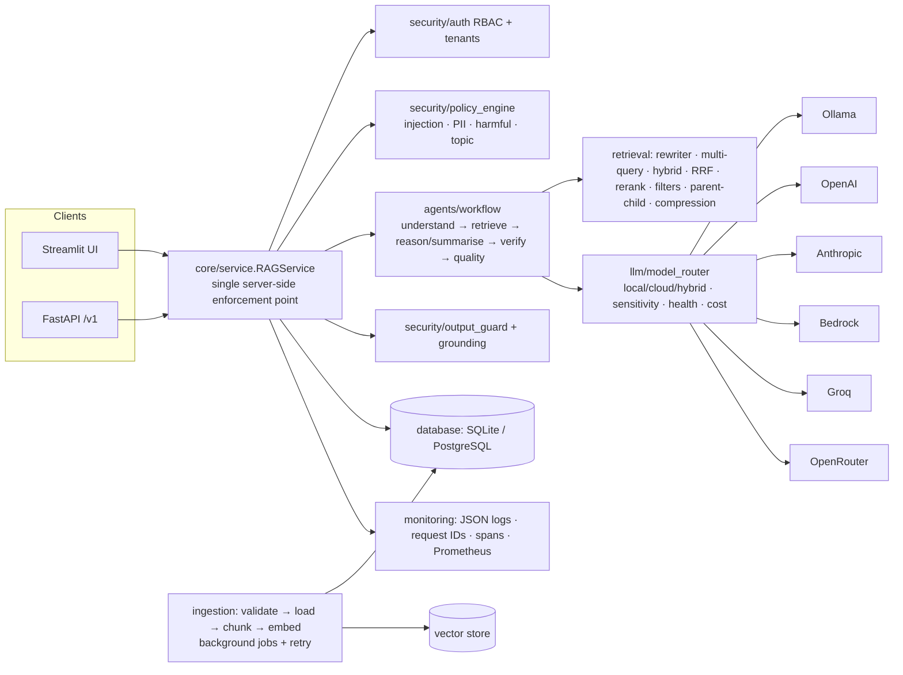

# Implementation Roadmap

Principle: **extend, don't rewrite.** Existing packages (`rag/`, `agents/`, `llm/`, `retrieval/`, `storage/`,
`metrics/`, `ops/`, `ui/`) stay where they are; new capabilities land in new packages that match the target
structure of the master prompt (`core/`, `ingestion/`, `security/`, `database/`, `monitoring/`, `evaluation/`,
`api/`). Existing public functions keep their signatures so the 96 baseline tests keep passing.

## Proposed architecture

## Decisions

| Decision | Options compared | Choice | Why |
|---|---|---|---|
| Relational store | SQLAlchemy+Alembic, raw sqlite3, SQLAlchemy+own migrator | **SQLAlchemy Core/ORM + small versioned migrator** | one code path for SQLite and PostgreSQL; migrations stay plain Python, no Alembic env boilerplate |
| Vector store | pgvector, Chroma, keep NumPy | **keep NumPy store**, chunk metadata in DB | pgvector extension is not installed here (untestable); datasheet-scale corpora fit in memory; interface kept swappable |
| LLM SDKs | vendor SDKs vs httpx | **httpx for Ollama/OpenAI/Anthropic**, boto3 (optional, lazy) for Bedrock | matches existing design; Bedrock needs SigV4 |
| API | FastAPI vs none | **FastAPI** (small) | health/metrics endpoints + server-side API with the same `RAGService` |
| Password hashing | bcrypt, argon2, PBKDF2 | **PBKDF2-HMAC-SHA256, 600 k iterations (stdlib)** | no native dependency; OWASP-recommended parameters |
| RAGAS | RAGAS vs own | **own deterministic metrics**, RAGAS optional | RAGAS needs an LLM judge + heavy deps; must run offline and never invent scores |
| Background ingestion | Celery/RQ vs thread pool | **ThreadPoolExecutor + DB job table** | no broker needed for small installs |

## Order
Phase 1 core service + logging → 2 ingestion (+ first DB tables) → 3 retrieval → 4 LLMs → 5 agents → 6 security →
7 evaluation → 8 UI → 9 DB completion/backup → 10 observability → 11 CI/CD/Docker → 12 validation.

## Files to preserve
All existing modules. Modified (backwards compatible): `config/settings.py`, `rag/pipeline.py`, `llm/*`,
`agents/rag_pro.py`, `agents/retrieval_stage.py`, `ops/guard.py`, `ui/*`, `app.py`, `Dockerfile`,
`docker-compose.yml`, `requirements*.txt`, `.env.example`.

## Dependencies to add
`sqlalchemy`, `psycopg[binary]` (PostgreSQL), `fastapi`, `uvicorn`, `python-docx`, `python-pptx`, `openpyxl`,
`pytesseract` (needs the tesseract binary), `python-multipart`; optional: `boto3`, `prometheus-client`,
`opentelemetry-sdk`. Dev: `ruff`, `bandit`, `pip-audit`. Nothing removed.

## Testing strategy
Keep the offline harness; extend the fake LLM server with Ollama, OpenAI, Anthropic protocols; add
`tests/unit`, `tests/integration`, `tests/security`, `tests/performance`; PostgreSQL integration tests run when
`TEST_DATABASE_URL` is set; Streamlit pages tested with `streamlit.testing.v1.AppTest`.
